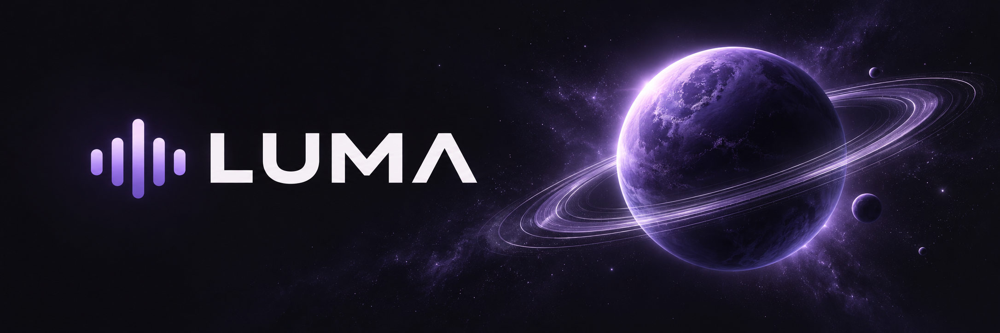
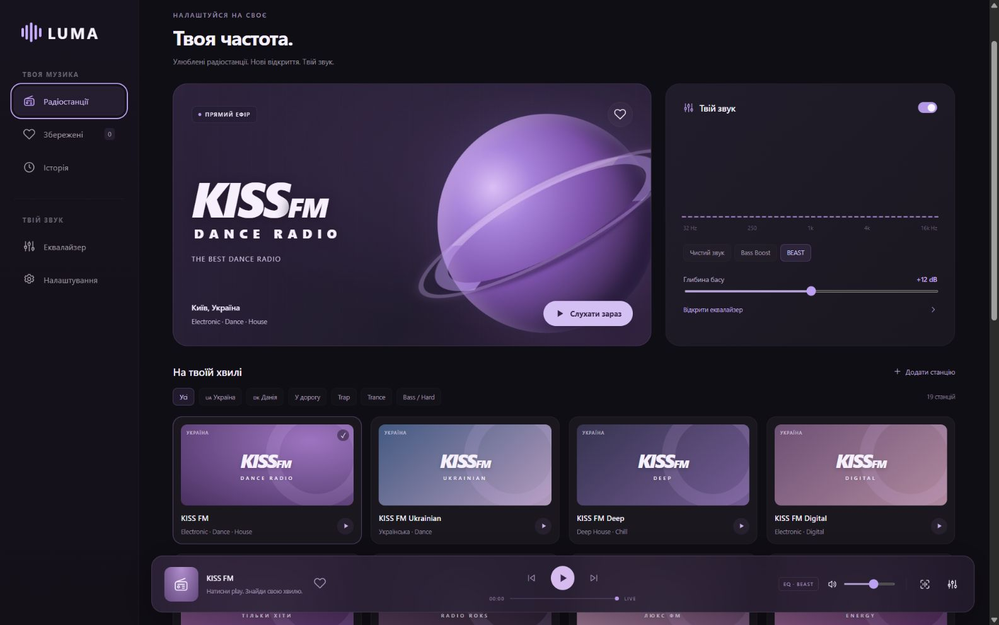
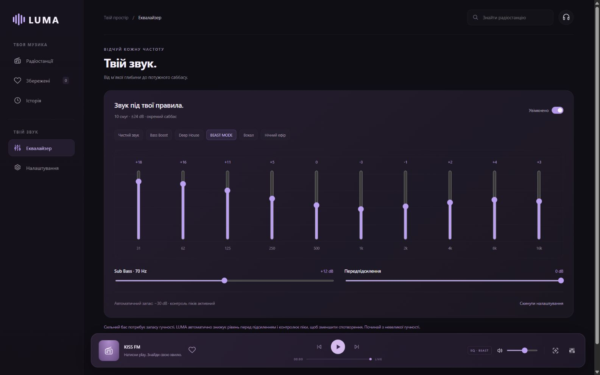
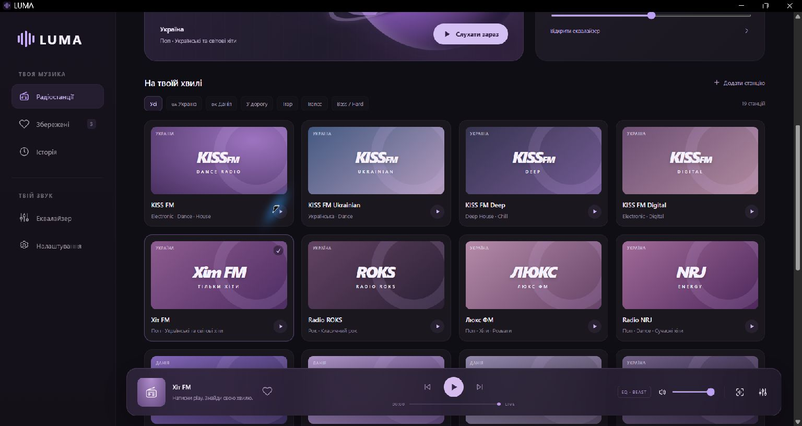

# LUMA

A Windows desktop radio player with 19 station presets, a powerful equalizer, saved track discoveries and overlays. Dark UI with violet accents. Requires a separately installed Node.js runtime.

**[Download v1.2.1 for Windows](https://github.com/ThunderBoldX/LUMA/releases/download/v1.2.1/LUMA-v1.2.1-windows-x64.zip)** · [All releases](https://github.com/ThunderBoldX/LUMA/releases) · [Українська](README.md) · [Installation](#installation)



## Who it is for

For people who listen to radio at their computer, want to adjust bass for their speakers or headphones, keep song names they discover, or share listening activity through Discord and OBS. LUMA plays internet streams; it is not an FM hardware receiver.

## Features

- **19 presets:** Ukrainian KISS FM and Ukrainian/Deep/Digital channels, Hit FM, Radio ROKS, Lux FM, NRJ, Avtoradio Ukraine, Perec FM and Radio Maximum; Danish The Voice, NOVA and Radio Soft; Trap · laut.fm, TranceBase.FM, HardBase.FM, TechnoBase.FM and SomaFM · Dub Step Beyond.
- Search, country/mood filters and custom direct HTTPS MP3/AAC streams.
- **10-band ±24 dB equalizer**, a 70 Hz sub-bass shelf up to +24 dB, preamp and six presets including BEAST MODE. Automatic input headroom and a compressor reduce distortion risk; this is not a true-peak limiter.
- Station-provided track names, history and a **saved collection**. Saves artist/title metadata, not audio files. Includes YouTube Music search, manual entry and JSON import/export.
- Optional **AudD** recognition of a 12-second audio sample. Requires your own token and quota. No official Shazam integration.
- Optional **Discord Rich Presence** through local IPC. Requires your own Application ID, uploaded artwork and the desktop Discord client.
- Transparent **OBS overlay**, artwork and metadata for compatible media panels, media keys and a sleep timer.

| Equalizer | Station catalog |
| --- | --- |
|  |  |

Screenshots show the actual Windows interface while paused. They do not prove that every stream or Discord is working. [demo-library.json](docs/demo-library.json) provides clearly marked fictional collection entries for your own demonstrations; it contains no credentials.

## Requirements

| Component | Requirement |
| --- | --- |
| Desktop package | Windows 10/11 x64, .NET Framework 4.8 or compatible 4.x |
| Runtime | **Node.js 22.13+**, installed separately |
| Window | Microsoft Edge recommended; falls back to your default browser |
| Network | Internet access to the broadcasters |
| Storage | Writable application folder |

No native macOS, Linux, Android or iOS release is provided. Responsive browser layout does not imply a native mobile app. Windows 10 and 11 have not each undergone a complete compatibility matrix.

## Installation

1. Install a currently supported [Node.js](https://nodejs.org/) release, version 22.13 or newer.
2. Download the ZIP from [GitHub Releases](https://github.com/ThunderBoldX/LUMA/releases), then extract the **entire folder** into a writable location such as `Documents\LUMA`.
3. Run **LUMA.exe**, choose a station and press **«Слухати зараз»** (Listen now). Playback does not start automatically. The app UI is Ukrainian.
4. To quit fully, right-click LUMA's purple system-tray icon and choose **«Зупинити та вийти»**. Closing the window alone leaves the local server running.

Verify the ZIP against `SHA256SUMS.txt` from the same release:

```powershell
Get-FileHash .\LUMA-v1.2.1-windows-x64.zip -Algorithm SHA256
```

When updating, quit LUMA and replace application files while **preserving the `data` folder**. Export your collection from Settings before updating.

## First setup

**Sound:** start at a low volume. Open «Еквалайзер» and select a preset or move the bands. Strong bass boosts automatically lower the input level to provide headroom, so overall loudness may decrease.

**Songs:** click the heart to save a known song name. If a station supplies no metadata, enter the song manually or configure your AudD token. The token stays in tab memory. Recognition sends a short audio sample to AudD and consumes your provider quota; automatic mode may make repeated requests.

**Discord:** create an application named **LUMA** in the [Developer Portal](https://discord.com/developers/applications). Put its Application ID into LUMA Settings. Under Rich Presence → Art Assets, upload `LUMA-Discord.png` with the asset key `luma`. Run desktop Discord, enable activity sharing there and click «Підключити» (Connect) in LUMA. Discord's application name comes from the Developer Portal. No Discord password or user token is required. Discord receives station/song text, not the audio. Activity clears after pausing, with a possible delay of up to 20 seconds.

**OBS:** copy the overlay URL from Settings and add a Browser Source sized **470 × 140**. The default is `http://127.0.0.1:4173/overlay`; use the actual URL if LUMA chooses a different port. OBS and LUMA must run on the same PC.

## Troubleshooting

| Problem | Check |
| --- | --- |
| Node.js not found | Install Node.js 22.13+, relaunch and check `node --version` |
| Windows blocks the EXE | The executable is unsigned. Check its source and SHA-256 or build from source; do not disable Windows protection |
| Station will not play | Internet, station availability and geographic restrictions; try another preset |
| Custom stream is silent | Use direct HTTPS MP3/AAC with CORS; a website URL or HLS playlist will not work |
| No song name | Not all stations provide metadata; try AudD or manual entry |
| No Discord activity | Desktop client, Application ID, asset key `luma`, Discord activity-sharing settings and LUMA connection status |
| OBS shows paused | Keep the player open and verify the overlay URL/port |
| Missing collection | A different browser profile or port has separate storage; restore your JSON export |

## Known limitations

- Broadcasters control streams, ads, latency and metadata. All 19 streams are not guaranteed to be reachable in every region or at all times.
- No HLS engine, DRM, offline playback, song downloads or cross-device synchronization.
- Data belongs to the browser profile and local origin/port. Private browsing is unsuitable for a persistent collection.
- Background playback and the timer depend on the browser and require the tab to remain open. Compatibility with every third-party overlay is not guaranteed.
- AudD and Discord integrations are implemented, but provider credentials are not included and require setup.

## Run from source

No npm packages are needed. Install Node.js 22.13+ first.

```powershell
git clone https://github.com/ThunderBoldX/LUMA.git
cd LUMA
node scripts/dev-radio.mjs
```

Open `http://127.0.0.1:4173`. This is a browser preview: **Discord and OBS routes are provided by the desktop package, not this dev server**. The equalizer processes only audio played inside LUMA.

To build the portable Windows package, use Windows, Node.js, Python 3 and the .NET Framework C# compiler:

```powershell
node scripts/build-release.mjs
```

The archive and checksums appear in `release/`. Packaging uses an explicit allowlist and excludes browser profiles, keys and user data. See [src/stations.json](src/stations.json) for presets, [src/index.html](src/index.html) for the UI and [src/discord-presence.cjs](src/discord-presence.cjs) for desktop Discord/OBS integration.

## Checks

```powershell
node scripts/test-radio.mjs
node scripts/test-presence.mjs
node scripts/check-docs.mjs
node scripts/build-radio.mjs
```

Tests use controlled responses for routing, metadata, filters, saved tracks, presets/headroom and simulated Discord IPC. They **do not** verify live radio availability, audio quality or an actual Discord card. Screenshots establish UI appearance, not external-service functionality. GitHub Actions is configured to run checks and build Windows artifacts; CI success depends on an actual workflow run.

## License

[MIT](LICENSE). Station content, trademarks and external services remain subject to their owners' rights. See [THIRD-PARTY-NOTICES.md](THIRD-PARTY-NOTICES.md).
