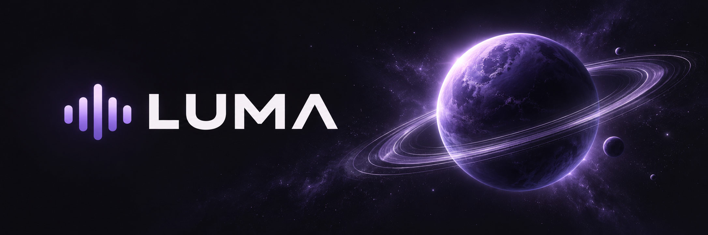
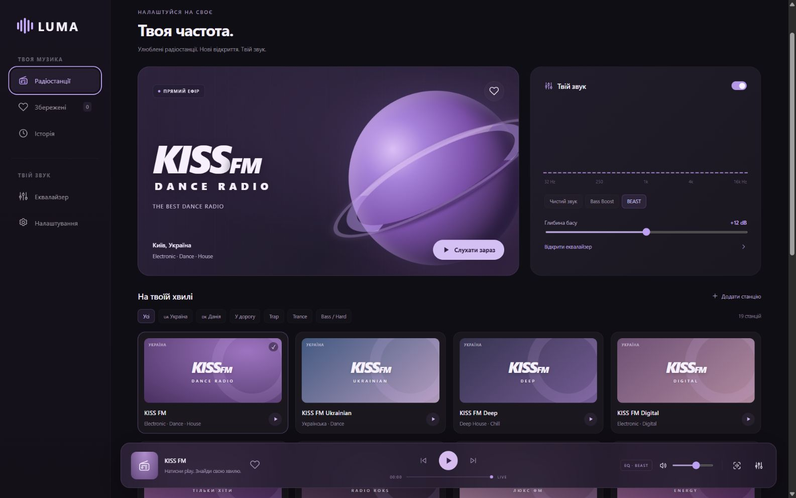
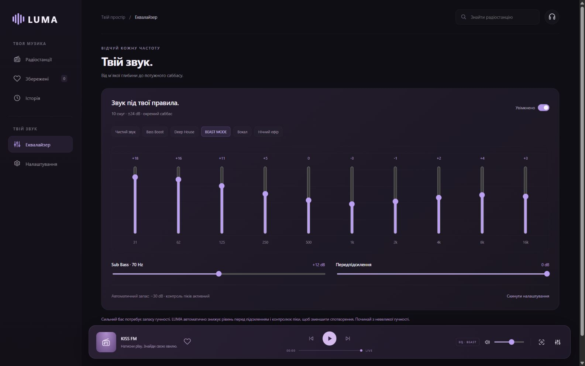
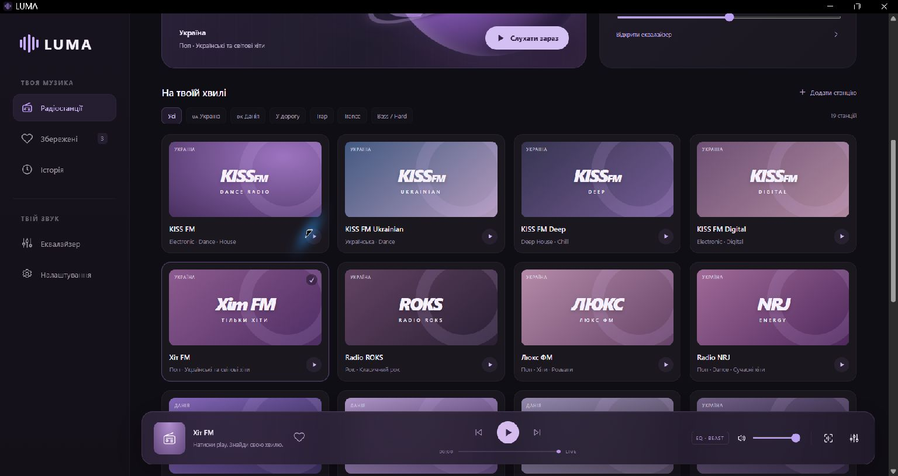

# LUMA

Радіоплеєр для Windows: 19 готових станцій, потужний еквалайзер, колекція знайдених треків та оверлеї. Темний інтерфейс із фіолетовими акцентами. Для запуску потрібен окремо встановлений Node.js.

**[Завантажити v1.2.1 для Windows](https://github.com/ThunderBoldX/LUMA/releases/download/v1.2.1/LUMA-v1.2.1-windows-x64.zip)** · [Усі релізи](https://github.com/ThunderBoldX/LUMA/releases) · [English](README.en.md) · [Встановлення](#встановлення)



## Для кого

Для тих, хто слухає радіо за комп’ютером, хоче налаштувати бас під свої навушники чи колонки, зберігати назви пісень і показувати прослуховування у Discord або OBS. Програма відтворює інтернет-ефір, а не FM-сигнал із приймача.

## Можливості

- **19 станцій:** українські KISS FM та три його канали, Хіт FM, Radio ROKS, Люкс ФМ, NRJ, Авторадіо Україна, Перець FM, Радіо Максимум; данські The Voice, NOVA, Radio Soft; Trap · laut.fm, TranceBase.FM, HardBase.FM, TechnoBase.FM, SomaFM · Dub Step Beyond.
- Пошук, фільтри країни та настрою, додавання власних HTTPS-потоків MP3/AAC.
- **10 смуг еквалайзера ±24 dB**, саббас 70 Гц до +24 dB, передпідсилення, шість пресетів, зокрема BEAST MODE. Автоматичний запас рівня та компресор зменшують ризик спотворень; це не лімітер істинних піків.
- Назви пісень з ефіру, історія та **«Збережені»**. Зберігаються назва й виконавець, а не аудіофайли. Є пошук пісні в YouTube Music, ручне додавання та імпорт/експорт JSON.
- Необов’язкове розпізнавання 12 секунд ефіру через **AudD**: потрібен власний ключ і доступна квота. Офіційний Shazam не інтегрований.
- Необов’язковий **Discord Rich Presence** через локальний IPC: потрібні Application ID, іконка в Developer Portal та настільний Discord.
- Прозорий **OBS-оверлей**, обкладинка й метадані для сумісних медіапанелей, медіаклавіші та таймер вимкнення.

| Еквалайзер | Каталог станцій |
| --- | --- |
|  |  |

Скриншоти знято зі справжнього інтерфейсу Windows-версії на паузі. Вони не демонструють підтверджену роботу всіх радіопотоків або Discord. Файл [demo-library.json](docs/demo-library.json) містить явно позначені вигадані записи для власних демонстрацій; особистих ключів або облікових даних у ньому немає.

## Системні вимоги

| Компонент | Вимога |
| --- | --- |
| Настільний пакет | Windows 10/11 x64, .NET Framework 4.8 або сумісний 4.x |
| Середовище | Node.js **22.13 або новіший**, встановлюється окремо |
| Вікно | Microsoft Edge рекомендований; інакше відкривається стандартний браузер |
| Мережа | Інтернет і доступ до серверів станцій |
| Зберігання | Папка програми має бути доступною для запису |

Нативних релізів для macOS, Linux, Android чи iOS немає. Адаптивний інтерфейс у браузері не означає підтримку нативного мобільного застосунку. Windows 10 та 11 не проходили окрему повну матрицю сумісності.

## Встановлення

1. Встанови актуальний підтримуваний [Node.js](https://nodejs.org/) версії 22.13+.
2. Завантаж ZIP із [GitHub Releases](https://github.com/ThunderBoldX/LUMA/releases) і розпакуй **усю папку** у власний доступний для запису каталог, наприклад `Documents\LUMA`.
3. Запусти **LUMA.exe**, обери станцію та натисни **«Слухати зараз»**. Станції не запускаються автоматично.
4. Для завершення роботи: правий клік на фіолетовому значку в системному треї → **«Зупинити та вийти»**. Закриття самого вікна не завершує фоновий сервер.

Перевір ZIP за файлом `SHA256SUMS.txt` із того самого релізу:

```powershell
Get-FileHash .\LUMA-v1.2.1-windows-x64.zip -Algorithm SHA256
```

Під час оновлення закрий LUMA, заміни файли програми й **збережи папку `data`**. Перед оновленням бажано експортувати колекцію з налаштувань.

## Перші налаштування

**Звук.** Почни з невеликої гучності. Відкрий «Еквалайзер», обери пресет або налаштуй смуги. Сильне підсилення басу автоматично зменшує вхідний рівень, тому загальна гучність може знизитися.

**Пісні.** Сердечко зберігає відому назву. Якщо станція не передає метадані, додай пісню вручну або введи свій ключ AudD у налаштуваннях. Ключ AudD живе лише в пам’яті вкладки. Розпізнавання передає короткий аудіофрагмент сторонньому сервісу та використовує його ліміт; авто-режим може робити повторні запити.

**Discord.** Створи застосунок **LUMA** у [Developer Portal](https://discord.com/developers/applications). Скопіюй Application ID у налаштування LUMA; у Rich Presence → Art Assets завантаж `LUMA-Discord.png` під назвою `luma`. Відкрий настільний Discord, дозволь показ активності у самому Discord і натисни «Підключити». Назва програми в Discord походить із Developer Portal. Пароль чи токен користувача не потрібні. Аудіо для цього не передається: Discord отримує назву станції й відомого треку. Після паузи активність очищується із можливою затримкою до 20 секунд.

**OBS.** У налаштуваннях скопіюй адресу оверлею, додай «Джерело браузера», установи розмір **470 × 140**. Типова адреса — `http://127.0.0.1:4173/overlay`; якщо порт зайнятий, копіюй фактичну адресу з програми. LUMA і OBS мають працювати на одному ПК.

## Типові проблеми

| Проблема | Що перевірити |
| --- | --- |
| LUMA не знаходить Node.js | Встанови Node.js 22.13+, перезапусти програму; перевір `node --version` у терміналі |
| Windows не дозволяє запуск | EXE не має цифрового підпису. Перевір джерело й SHA-256; за потреби збери з відкритого коду. Не вимикай захист Windows |
| Станція не грає | Інтернет, доступність і регіональні обмеження джерела; спробуй іншу станцію |
| Власна станція мовчить | Потрібне пряме HTTPS-посилання MP3/AAC та CORS; сторінка сайту або HLS-плейлист не підходить |
| Немає назви пісні | Станція може не передавати її; спробуй AudD або ручне додавання |
| Discord не показує активність | Настільний Discord, Application ID, назва іконки `luma`, показ активності та статус підключення в LUMA |
| OBS показує паузу | Плеєр має залишатися відкритим; перевір порт і адресу оверлею |
| Колекція зникла | Інший браузер, профіль або порт створює окреме сховище; віднови JSON-експорт |

## Відомі обмеження

- Радіопотоки контролюють мовники: доступність, затримка, реклама та назви треків можуть змінюватися. Немає гарантії, що всі 19 потоків одночасно працюють у твоїй країні.
- Немає HLS-рушія, DRM, офлайн-прослуховування, завантаження пісень чи синхронізації між пристроями.
- Локальні дані прив’язані до профілю браузера й адреси/порту. Не використовуй приватний режим для постійної колекції.
- Фонове відтворення й таймер залежать від браузера; вкладка має залишатися відкритою. Сумісність усіх сторонніх оверлеїв не гарантується.
- Discord і AudD — готові інтеграції, але не сервіси з включеними обліковими даними. Їх треба налаштувати самостійно.

## Запуск із коду

Клієнт і сервер не потребують npm-пакетів. Потрібен Node.js 22.13+.

```powershell
git clone https://github.com/ThunderBoldX/LUMA.git
cd LUMA
node scripts/dev-radio.mjs
```

Відкрий `http://127.0.0.1:4173`. Це браузерний попередній перегляд; **Discord та OBS-маршрути доступні в настільному пакеті**, а не в цьому dev-сервері. Вбудований еквалайзер працює лише зі звуком цього плеєра.

Для збирання Windows-пакета потрібні Windows, Node.js, Python 3 та компілятор C# із .NET Framework:

```powershell
node scripts/build-release.mjs
```

Архів і контрольна сума з’являться у `release/`. Пакувальник використовує явний список файлів і не включає профіль браузера, ключі чи користувацькі дані. Каталог станцій — [src/stations.json](src/stations.json), інтерфейс — [src/index.html](src/index.html), локальний Discord/OBS — [src/discord-presence.cjs](src/discord-presence.cjs).

## Перевірки

```powershell
node scripts/test-radio.mjs
node scripts/test-presence.mjs
node scripts/check-docs.mjs
node scripts/build-radio.mjs
```

Автоматичні тести перевіряють маршрути на тестових відповідях, парсинг метаданих, фільтри, колекцію, пресети й запас рівня, а також змодельований Discord IPC. Це **не** перевірка живого ефіру, звукової якості або реальної картки Discord. Скриншоти підтверджують вигляд інтерфейсу, а не роботу зовнішніх сервісів. GitHub Actions запускає перевірки й збирає Windows-пакет; успіх CI визначається фактичним запуском workflow.

## Ліцензія

[MIT](LICENSE). Права на музику, назви станцій і сторонні сервіси залишаються їхнім власникам; див. [THIRD-PARTY-NOTICES.md](THIRD-PARTY-NOTICES.md).
